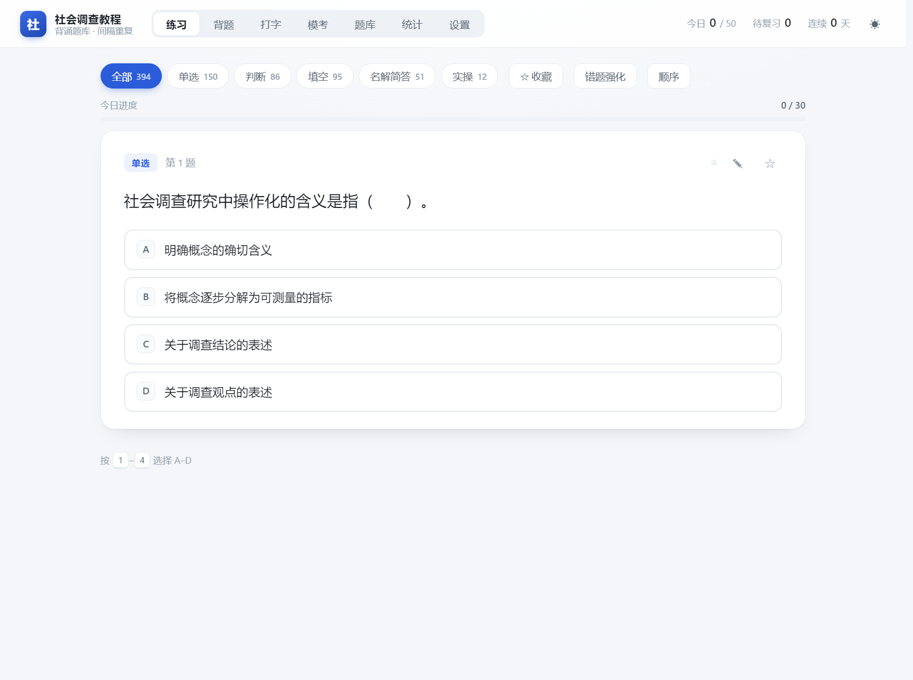
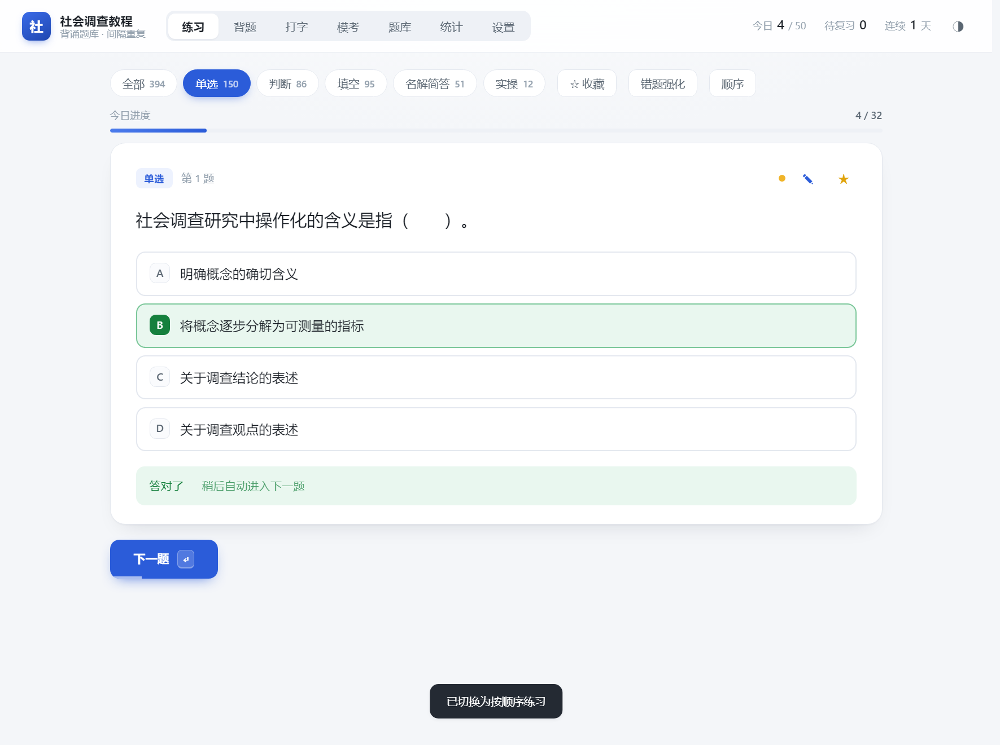
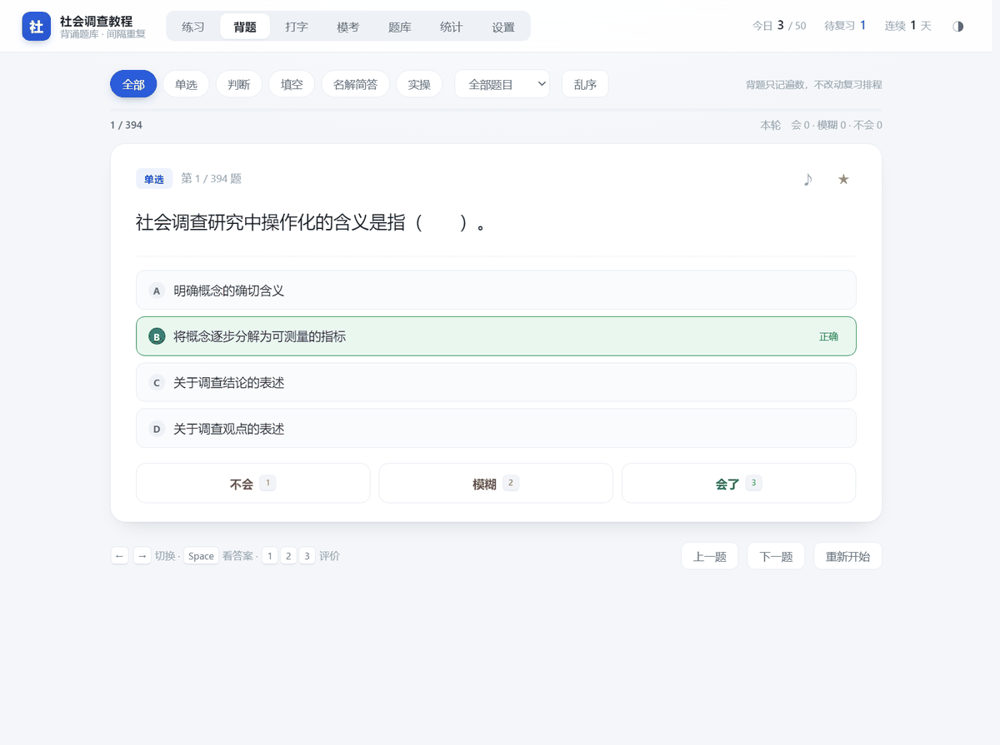
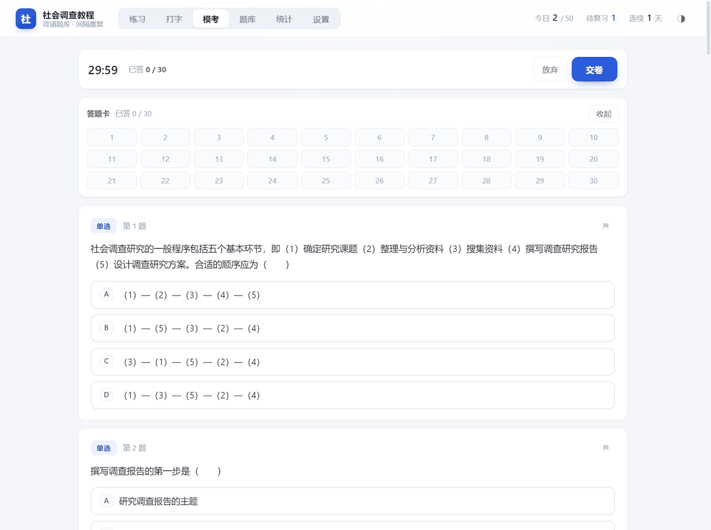
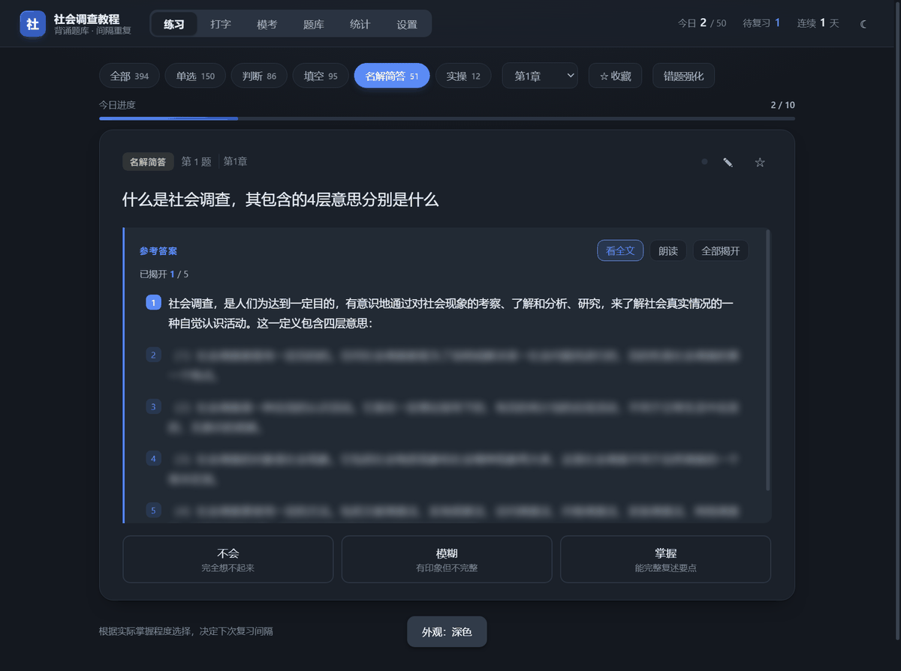

# 社会调查背诵题库

《社会调查教程》课程题库的离线背诵工具。把 5 个 Word 题库（394 题）转成一个按记忆规律推题的 Windows 桌面应用。

Electron 33 + 原生 HTML/CSS/JS，无前端框架、无构建步骤。

## 下载

Windows 64 位：到 [Releases](https://github.com/qicongwei/social-survey-quiz/releases/latest) 下载 `社会调查背诵题库-*-win32-x64.zip`，解压后双击文件夹里的 `社会调查背诵题库.exe`。

- **整个文件夹一起用**，exe 依赖同目录的 dll 与 `resources/`，单独复制 exe 到别处跑不起来
- 免安装、不联网，进度存在 `%APPDATA%\社会调查背诵题库\progress.json`
- 首次运行若弹「Windows 已保护你的电脑」，点「更多信息 → 仍要运行」（未做数字签名，属正常现象）

想自行构建或改代码见下方「开发运行」。












## 功能

- **按题型自动匹配交互**：单选 / 判断 / 填空直接作答并即时判分；名词解释 / 实操题先默想再展开参考答案，自评「不会 / 模糊 / 掌握」
- **答对自动跳题，答错留住**：答对后停顿 0.8 秒自动进入下一题（按钮底部有倒计时进度条），答错不跳，留时间看正确答案，自己按「下一题」或 `Enter` 再走；可在设置里关掉自动跳题
- **顺序 / 乱序**：工具栏一个按钮切换，对所有练习模式（题型、章节、收藏、错题强化、额外加练）统一生效，选择随进度保存
- **额外加练不重复**：本轮已经出现过的题不会再被「再来 10 题」抽到，全练完了才允许从头再来
- **背题模式**：一屏一题，**答案直接展示**（可切「遮盖答案」改回先自测再核对），看完按「不会 / 模糊 / 会了」打分，自动翻下一题。**只记遍数、不改动复习排程**，适合考前快速刷遍数；一轮结束给出通过率，并可「只背不会的」
- **背题 · 填空照着打**：填空题在背题页多出一个输入区，照着上面的答案逐字敲，打对的字亮绿底、打错标红、当前位标下划线，整空全对后行变绿并打勾；多空题逐空分行，`Enter` 跳下一空。答案文字本身承担进度反馈，不用另开「打字训练」页
- **逐句背**：长答案切成要点后逐句模糊遮盖，点一句揭开一句，可一键全揭 / 全遮；附「已揭开 x / y」计数
- **打字训练**：对着大段参考答案逐字输入，实时比对染色（正确 / 打错 / 当前位置）、计时与评分；支持「对照打」与「默打」（参考区模糊），漏打或多打一个字会自动对齐不连锁错位
- **模拟考试**：从客观题随机组卷（20 / 30 / 50 题），限时作答、到点自动交卷，交卷后给出分数、正确答案与错题回顾；配答题卡网格，可跳题、标记待定，交卷前列出未答题号
- **题目笔记**：每道题可写记忆口诀或易错点，随进度保存；题库可全文检索笔记内容，导出错题本时一并带上
- **收藏夹**：标星重点题后可切到「收藏」单独轮练，题库支持「只看收藏」
- **每日目标**：设定当天答题目标，顶栏实时显示进度，达成时提示
- **深色主题**：浅色 / 深色 / 跟随系统三档，启动不闪白
- **间隔重复**：简化 SM-2，答对间隔按 1 → 3 → 7 → 15 → 30 天递增；模糊间隔减半；答错打回并在当天再出现一次
- **每日配额**：新题与复习各设上限，只推「今天到期」的题，不做全库轮巡
- **错题强化**：只练做错过的题（按错误次数优先，或随全局切乱序）。**每道题要连续答对 2 次才算过关**，答错清零并排到本轮队尾，直到过关或本轮重现次数用尽；进度条显示「剩余 n 题」
- **题库检索**：全文搜索、展开查看选项与答案、只看错题；名解简答可按章节单独练；任意题可一键「练这题」
- **统计**：掌握度分布、背题覆盖、未来 7 天到期柱状图、近 12 次打字成绩趋势、近 12 周学习热力图、薄弱题排行
- **朗读**：调用系统语音朗读题干与参考答案，边听边背
- **错题导出**：把错题连同答案、笔记导出为 Markdown，可直接打印
- **进度可迁移**：导出 / 导入 JSON，换机续接

快捷键：`1–4` 选选项 · `1/2` 判对错 · `Enter` 下一题/提交 · `Space` 看答案 · `S` 收藏 · `N` 记笔记 · `Esc` 收起笔记

背题模式另有一套：`1/2/3` 不会/模糊/会了 · `Space` 下一题（遮盖模式下先显示答案）· `←` `→` 切题 · `S` 收藏
填空题的打字框里：`Enter` 跳到下一空 · `Esc` 退出输入，之后 `1/2/3` 才生效（光标在框内时键盘属于输入）

## 题量

| 题型 | 题数 | 说明 |
|---|---|---|
| 单项选择 | 150 | 4 选项，答案 A–D |
| 判断 | 86 | √ / × |
| 填空 | 95 | 含多空题，答案按 ①② 拆分 |
| 名词解释/简答 | 51 | 按章节分组 |
| 实操 | 12 | 综合设计、抽样计算，含 1 道表格题 |
| **合计** | **394** | |

解析由 `_tools/parse.py` 完成，校验报告见 `_tools/validate.txt`，仅有 4 条告警且全部是原文缺陷（2 题缺题号、实操实为 12 题、第 12 题无参考答案）。

## 目录结构

```
.
├── data/questions.json          解析后的结构化题库
├── _tools/
│   ├── parse.py                 docx → JSON 解析器（同时同步前端数据）
│   ├── make_icon.py             生成应用图标（需 Pillow）
│   └── validate.txt             解析校验报告
├── app/                         Electron 应用
│   ├── main.js                  主进程（窗口 + 进度文件读写）
│   ├── preload.js               安全桥（contextIsolation）
│   ├── package.json
│   ├── assets/                  图标输出目录（需先运行 make_icon.py）
│   └── renderer/
│       ├── index.html
│       ├── css/style.css
│       ├── js/store.js          进度持久化（IPC 写文件 / localStorage 兜底）
│       ├── js/scheduler.js      间隔重复排程
│       ├── js/typing.js         打字训练（逐字对齐、自愈、评分）
│       ├── js/exam.js           模拟考试（组卷、计时、判分、答题卡）
│       ├── js/recite.js         背题模式（一屏一题、自评遍数，不写排程）
│       ├── js/theme-boot.js     启动前预置主题（防闪白）
│       ├── js/app.js            答题状态机与视图
│       └── data/questions.js    题库内联副本
└── 使用说明.txt
```

## 开发运行

```bash
cd app
npm install
npm start
```

> 若命令行环境设置了 `ELECTRON_RUN_AS_NODE=1`，需先清除，否则 `app` 为 undefined。

## 打包

```bash
cd app
python ../_tools/make_icon.py          # 生成 assets/icon.ico
set ELECTRON_MIRROR=https://npmmirror.com/mirrors/electron/
node_modules\.bin\electron-packager . 社会调查背诵题库 ^
  --platform=win32 --arch=x64 --out=..\dist --overwrite ^
  --icon=assets/icon.ico --asar --ignore=_shot --ignore=_test
```

打包产物约 269 MB，须整目录分发（exe 依赖同目录 dll 与 resources）。

发行版自检：

```bash
社会调查背诵题库.exe selftest
# 读取 %APPDATA%\社会调查背诵题库\selftest.json
# 期望 {"questions":394,"opts":4,"api":true}
```

## 更新题库

1. 把 5 个题库 docx（单选 / 判断 / 填空 / 名解简答 / 实操）放到同一个文件夹，文件名保持不变
2. 让脚本找到这批 docx（不设则用当前工作目录）：
   ```bash
   set QUIZ_SRC=D:\path\to\docx_dir
   python _tools\parse.py
   ```
   脚本会重新解析并在 `_tools/validate.txt` 写校验报告，同时自动同步 `app/renderer/data/questions.js`
3. 看报告里的告警，必要时在 `_tools/parse.py` 补解析规则

## 数据来源与声明

题库来自课程发放的《社会调查教程》配套练习材料，仅用于个人复习。题目著作权归原编者与出版方所有，**本项目不对题库内容主张任何权利，也不鼓励再分发**。

## 许可

代码与构建脚本：MIT，见 [LICENSE](LICENSE)。
题库内容不在 MIT 授权范围内，仅限个人学习使用。
